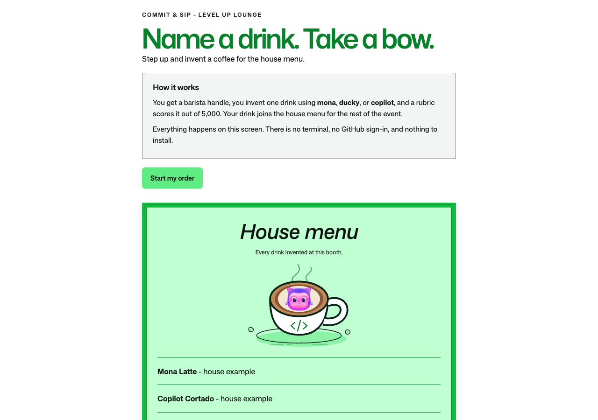
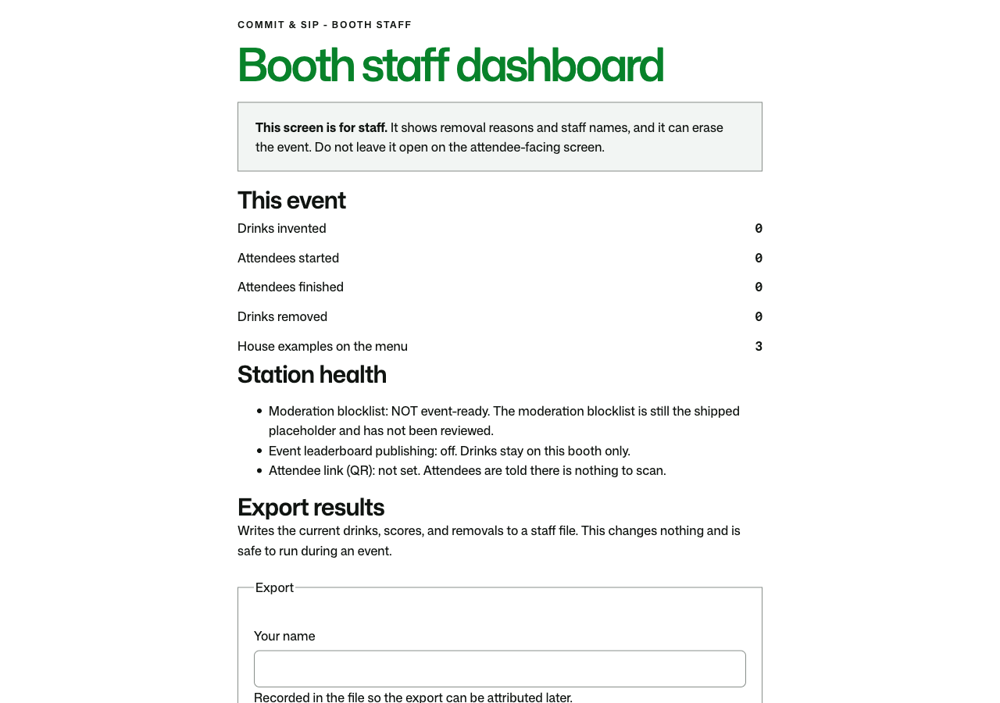
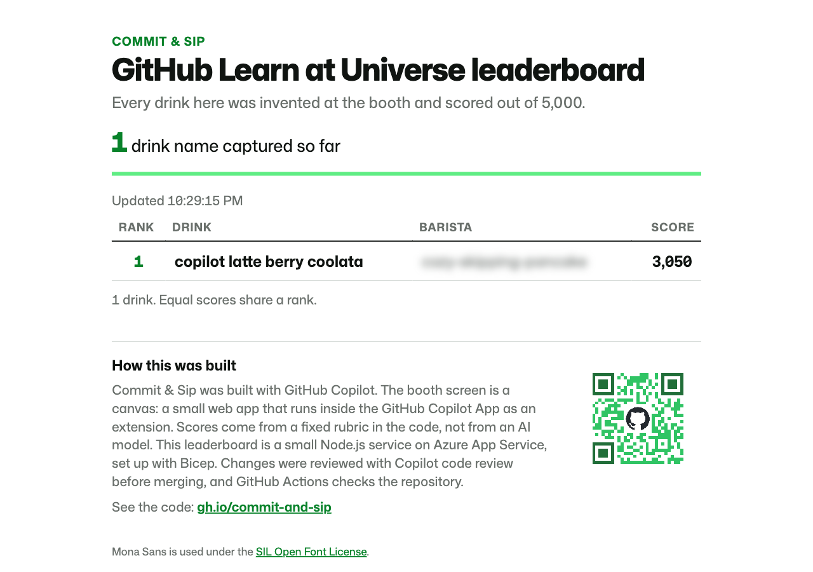

# Commit & Sip

**Order Up at the Level Up Lounge:** a five-minute, app-only naming competition. Invent one coffee that carries `mona`, `ducky`, or `copilot`, get it scored out of 5,000 by a local rubric, and put it on the house menu for the rest of the event.

## How this was built

Commit & Sip was built with GitHub Copilot, working in the GitHub Copilot App. It has three parts:

- **The booth canvas.** The screen attendees use is a canvas: a small web app that runs inside the GitHub Copilot App as a project extension ([`.github/extensions/commit-and-sip/`](.github/extensions/commit-and-sip/)), built on the Copilot SDK's canvas API. It runs on the booth machine and keeps its data there.
- **The score.** A fixed rubric in the code ([`services/name-score.mjs`](.github/extensions/commit-and-sip/services/name-score.mjs)) scores each name out of 5,000. No AI model judges it.
- **The leaderboard.** A small Node.js service that uses only Node's built-in modules ([`leaderboard-service/`](leaderboard-service/)), hosted on Azure App Service and described in Bicep ([`infra/`](infra/)). Each booth sends its drinks to it, and staff can take one down.

Every pull request was reviewed with Copilot code review, and GitHub Actions validates the repository. The booth's served screen and the public leaderboard both carry this summary and a QR code for <https://gh.io/commit-and-sip>, which leads here.

## One step, entirely in the App

**Audience:** beginners and GitHub-curious booth attendees. **Goal:** invent a drink name nobody has served here yet. **Duration:** about five minutes, with no speed or hint penalties.

You need only the booth's preconfigured Copilot App. No coding, cloning, account setup, GitHub sign-in, terminal, or external editor is required, and the attendee never opens a pull request. Staff supply the device and handle setup and recovery.

**Open:** click **Commit & Sip** with no input. The booth canvas is the default canvas and takes no open input; the counter opens idle and ready.

**Start:** choose **Start my order**. The station mints a barista handle, then follow **Step 1: Name a drink for the house menu**: type a name that includes a mascot (Copilot, Ducky, or Mona) and choose **Add it to the menu**. The [canonical learner step](.github/steps/1-name-a-drink.md) matches what the screen tells you.

**Finish:** read the score breakdown, take your place on the leaderboard, then choose **I'm done - hand over to the next barista**. That clears the counter for the next attendee; your drink stays on the menu and your entry stays on the leaderboard. See the [reset procedure](booth/RUNBOOK.md#reset-between-attendees).

Mona Latte, Copilot Cortado, and Ducky Cold Brew are worked examples. They are never scored and never appear on the leaderboard. The menu is first come, first served, so a name already taken is reported back and you try another.

This is a canvas-led adaptation of a GitHub Skills exercise: one learner step with several activities, not a five-step course. Staff setup is outside the learner step. Actions validate the repository; they do not drive learner transitions, create exercise issues, or gate play on workflow queue time. There is no Step 2 or automatic issue closure.

## Status: a working booth station, not event-ready

Commit & Sip is a project-local Copilot App canvas extension, registered as `commit-and-sip`. The booth flow runs end to end today: handle, name validation, rubric score, house menu, standings, and hand-over all work locally and persist across panel closure and extension reload.

It is **not** event-ready. One human review is outstanding, and it is not code:

- **Brand, trademark, and privacy review** of the mascot names and artwork has not happened, and the attendee screen already carries the official Mona mascot in the cup. See [the asset checklist](.github/images/README.md) for its provenance and what happens if review says no.

Already in place:

- **The moderation blocklist is reviewed.** `booth/blocked-terms.json` holds a short curated list, approved by arilivigni on 2026-10-22 (see [sourcing the blocklist](docs/blocklist-sourcing.md)). Re-review it before each event. Staff can take a drink down after the fact with `npm run remove`, which covers what any list misses.
- **The leaderboard service is live.** [The service](docs/leaderboard-service.md) runs at <https://commit-and-sip-leaderboard.azurewebsites.net> (short link <https://gh.io/commit-and-sip-leader>). It was last redeployed on 2026-10-22 from `main` with the reviewed blocklist, and accepts the current booth client. Changes to `leaderboard-service/` made after that deploy reach the live site only when someone with Contributor redeploys (see the runbook). **Every booth's attendee QR points at the short link by default**; set `leaderboardUrl` to `null` to turn it off at one booth. The board's names are moderated with the same reviewed blocklist as the booths, and staff takedown covers what it misses. Publishing is local-first, so an unreachable service never blocks an attendee.
- **Both short links resolve.** <https://gh.io/commit-and-sip-leader> redirects to the leaderboard service and keeps the query string, so each attendee's personal code (`?handle=…&ref=…`) still opens their own row. <https://gh.io/commit-and-sip> points at this repository, which is public.

The earlier pull-request review flow, its live and canvas-pilot modes, and its provisioning scripts have been removed. No code path in this repository reads or writes GitHub.

## Run Commit & Sip in the GitHub Copilot App

A booth runs three panels side by side in the GitHub Copilot App: the attendee canvas, the staff canvas, and a browser canvas showing the shared leaderboard. Staff set this up; attendees only ever touch the attendee canvas.

### Before you start

You need:

- A GitHub account with a Copilot plan, or your own model provider configured in the App.
- [Git](https://github.com/git-guides/install-git).
- Node.js 22 or newer. The pinned version is in [`.nvmrc`](.nvmrc).
- For Copilot Business or Copilot Enterprise, the organization's **GitHub Copilot app** policy must stay enabled. It is on by default and is separate from the Copilot CLI policy.

### Install the GitHub Copilot App

1. Go to the [GitHub Copilot app download page](https://github.com/features/ai/github-app) and download the build for your operating system. Direct links: [macOS (Apple silicon)](https://gh.io/copilot-app-mac), [macOS (Intel)](https://gh.io/copilot-app-mac-intel), [Windows (x64)](https://gh.io/copilot-app-win64), [Windows (Arm)](https://gh.io/copilot-app-win-arm), [Linux](https://gh.io/copilot-app-linux).
2. Install it as you would any desktop app. On macOS, open the downloaded disk image and drag the App into **Applications**. On Windows, run the installer.
3. Open the GitHub Copilot App and click **Sign in to GitHub**, then follow the prompts in your browser. If you use GitHub Enterprise Cloud with data residency, choose **Use GitHub Enterprise** and enter your `*.ghe.com` hostname. GitHub Enterprise Server is not supported.
4. If you have no Copilot plan, choose whether to sign up for one or continue with your own model provider.
5. When you're asked to pick repositories, you can select `ghlearn/commit-and-sip` now or skip and add it in the next section. Choose a theme to finish onboarding.

See [Getting started with the GitHub Copilot app](https://docs.github.com/en/copilot/get-started/quickstart-copilot-app) for the full walkthrough.

### Add Commit & Sip as a project

1. In the App sidebar, next to **Projects**, click **+**.
2. Under **Add project from**, choose **GitHub repository** and pick `ghlearn/commit-and-sip`, or choose **Repository URL** and enter `https://github.com/ghlearn/commit-and-sip`. If you've already cloned it, choose **Local folder or repository** and select that folder.
3. Once the project appears under **Projects**, click **+** next to it to start a new session. Pick **Interactive** from the mode dropdown under the prompt box.
4. Install development dependencies once on the booth machine, so the QR encoder is available. From the repository root in a terminal, or by asking Copilot in the session to run them:

   ```sh
   nvm use
   npm ci
   ```

The Commit & Sip canvases ship with the repository as a project canvas extension in [`.github/extensions/commit-and-sip/`](.github/extensions/commit-and-sip/). There's no plugin to install from **Customize**, and no SDK package to add; the App loads the extension from the project.

### Open the canvases

Canvases open in the App's right side panel. Copy each prompt below with its copy button and paste it into the session's prompt box.

**Fastest setup: one prompt.** On a booth machine that publishes to the leaderboard, paste this. Copilot asks where your `local-config.json` is before it opens anything:

```text
Ask me for the location of the folder or file that holds the booth's local-config.json (the leaderboard keys).
Copy it, don't symlink it, to booth/local-config.json without ever exposing the keys: first create an empty temporary file next to the destination and make it owner-only (chmod 600 and chmod -N on macOS), then copy the contents into that file, then rename it over booth/local-config.json. Never print or echo the keys.
Reload extensions and confirm commit-and-sip is running.
Then open the Commit & Sip attendee canvas, the Commit & Sip staff canvas, and a browser canvas at https://gh.io/commit-and-sip-leader.
```

Give Copilot the path only; never paste the keys into the chat. The steps below do the same thing one at a time.

1. **Load the extension.** Ask Copilot:

   ```text
   Reload extensions and list them.
   ```

   Confirm the project extension `commit-and-sip` shows as **running**. A moderation warning on start means the blocklist is still unreviewed. If the extension is missing or failed, ask Copilot for its log before continuing:

   ```text
   Show the log for the commit-and-sip extension.
   ```

2. **Open the attendee canvas.** Ask Copilot:

   ```text
   Open the commit-and-sip canvas with no input.
   ```

   The counter opens idle with **Start my order** and the house menu.

   

3. **Open the staff canvas.** Ask Copilot:

   ```text
   Open the commit-and-sip-admin canvas with no input.
   ```

   It shows event totals, station health, export, takedown, and end-of-event controls. Keep it off the attendee-facing screen: it shows staff names and removal reasons, and it can erase the event.

   

4. **Open the leaderboard.** Ask Copilot:

   ```text
   Open a browser canvas at https://gh.io/commit-and-sip-leader.
   ```

   The short link redirects to the live leaderboard service, which ranks every booth's drinks by score. If your booth uses a different short leaderboard URL, put yours in this prompt and in the all-at-once prompt below (see [Leaderboard URLs](#leaderboard-urls)).

   

To open all three at once, ask Copilot:

```text
Open the Commit & Sip attendee canvas, the Commit & Sip staff canvas, and a browser canvas at https://gh.io/commit-and-sip-leader.
```

If Copilot reports that no canvas matches `commit-and-sip`, the extension has not loaded yet: reload extensions, confirm it is running, then ask again. Make sure the session was started from the project under **Projects**, not from **Chats**: the extension lives in the repository, and a chat has no project checkout.

Reopening a panel reads saved state, so closing one never resets the booth. The leaderboard panel is separate from the attendee QR code, which every booth shows by default (see [staff configuration](#staff-configuration-and-data)).

The screenshots are the canvas pages captured with Playwright, not the surrounding App window. The barista handle on the leaderboard is blurred.

## Staff: open the booth

Staff need Node.js 22 or newer and a Copilot App/CLI build supporting project canvas extensions. The pinned version lives in `.nvmrc`; run `nvm use` before npm scripts. Open this repository in that host.

1. Reload extensions after checking out or changing extension files.
2. List extensions and confirm the project `commit-and-sip` extension is loaded. If it fails, inspect its entry and log before continuing.
3. Watch the log on start. A moderation warning means the blocklist is still unreviewed.
4. Inspect the registered `commit-and-sip` canvas capabilities.
5. Open the canvas with no input, or `{}`. The counter opens idle and ready for the next attendee.

Staff operations live on a second canvas, `commit-and-sip-admin`: event totals, results export, drink takedown, closing an abandoned station, the end-of-event archive and reset, and, on a staff machine, clearing the shared public leaderboard. It is deliberately not part of the attendee screen, which faces a queue. See the [staff dashboard](booth/RUNBOOK.md#staff-dashboard), [taking a drink down](booth/RUNBOOK.md#taking-a-drink-down), and [ending an event](booth/RUNBOOK.md#ending-an-event).

An agent driving the host uses `extensions_reload`, `extensions_manage` (`list`/`inspect`), `list_canvas_capabilities`, `open_canvas`, and `invoke_canvas_action`. These are host tools, not shell commands. Discover the loaded extension and provider identifiers instead of inventing them. Choose a panel `instanceId` when opening, then reuse that panel handle for actions.

The host resolves `@github/copilot-sdk/extension` automatically. Do not install an SDK package to run the extension. Maintainers use:

```sh
nvm use
npm ci
npm test
npm run check
```

`npm ci` installs development dependencies, including the QR generator; it is not an attendee step.

`npm test` and `npm run check` refuse to start on Node older than the `engines` floor, and `npm ci` fails the same way because `engine-strict` is enabled. That guard is deliberate: on Node 18 the loopback `fetch` suites leave experimental undici handles open, so the run hangs forever instead of reporting failures. The suite also runs with a per-test timeout and forced exit, so a leaked handle cannot stall it.

## What attendees practice

- Read the constraints before submitting: at least one mascot placed anywhere, an allowed character set, and no duplicate already on the menu.
- Treat a published rubric as something you can reason about and improve against, rather than guessing at a black box.
- See their own contribution land on a shared artifact that the rest of the event can see.

Scores run from 1 to **5,000**, a score one valid name can actually reach, and come from a deterministic rubric in code, not a language model. The same name always scores the same, and no two drinks share a score: if another drink already holds yours, tweak the name and submit again. With the event leaderboard configured, a drink joins the menu only once the leaderboard admits it. Speed, retries, and accessibility assistance do not reduce a score. Mona Latte, Copilot Cortado, and Ducky Cold Brew are worked examples: never scored, never ranked.

## Documentation

| Document | Audience |
| --- | --- |
| [Step 1: Name a drink for the house menu](.github/steps/1-name-a-drink.md) | Canonical learner instructions |
| [Learner entry guide](docs/learner-guide.md) | Attendees and facilitators |
| [Booth staff cheat sheet](booth/CHEAT-SHEET.md) | Quick launch prompts, attendee flow, fixes, and safe closing |
| [Booth runbook](booth/RUNBOOK.md) | Setup, moderation, recovery, reset, and event staff |
| [Blocklist sourcing proposal](docs/blocklist-sourcing.md) | Whoever owns the moderation decision |
| [Leaderboard service](docs/leaderboard-service.md) | Whoever deploys or operates the event leaderboard |
| [Integration contract](docs/integration-contract.md) | Leaderboard and service implementers |
| [Architecture and validation](docs/architecture.md) | Maintainers |
| [Asset capture checklist](.github/images/README.md) | Authentic screenshots, accessible QR, branding |
| [Order Up skill](.github/skills/order-up/SKILL.md) | In-app guided facilitation |
| [Approved exercise outline](docs/exercise-outline.md) | Preserved design source |

The approved outline is preserved verbatim, including its original proposals and open questions. It describes the original pull-request shape of this exercise. The booth naming competition supersedes it; current decisions live in this README, the architecture notes, and the integration contract, not in edits to that preserved source.

## Staff configuration and data

The booth reads one optional ignored file, `booth/local-config.json`, with two independent settings. A publishing booth's file looks like this:

```json
{
  "leaderboardApi": {"url": "https://<app>.azurewebsites.net", "boothKey": "<64 hex>", "staffKey": "<64 hex>"}
}
```

- `leaderboardApi` makes the booth **publish** to the leaderboard service, and lets takedowns retract from it. Write it with `npm run leaderboard:configure`, never by hand. Omit `staffKey` on a machine that should not take drinks down.
- `leaderboardUrl` puts a **QR code** in front of attendees, linking to their own place on a public page of attendee names. It defaults to the event short link `https://gh.io/commit-and-sip-leader`, so leave it out of the file unless this booth uses a different board. Add `"leaderboardUrl": null` only to turn the QR off at this booth.

Both URLs must be public HTTPS with no credentials, fragment, or nonstandard port. The file is readable only by its owner and is never packaged or committed. Retired pull-request keys such as `mode`, `runs`, `repo`, and `requiredChecks` are rejected on start rather than ignored, so a stale config cannot look configured. The two API keys belong in that file and nowhere else: not in the renderer, the repository, or a QR URL.

State persists in `$COPILOT_HOME/extensions/commit-and-sip/artifacts/ledger.json`; `COPILOT_HOME` defaults to `~/.copilot`. Staff may set `COMMIT_AND_SIP_DATA_DIR` to an absolute directory before the host launches. The store uses `ledger.lock` and atomic, fsynced writes. Closing or reloading a panel does not reset the booth, and hand-over does not erase the house menu.

Exports and archives are written beside the ledger, under `exports/`, and never into the repository. **Deleting the cloned repository does not delete attendee data** — it deletes the reviewed blocklist and staff configuration while leaving every name and removal record on the machine. End an event through the dashboard, then copy the archive off the device.

Neither a device's loopback renderer nor repository assets are public phone destinations, which is why the attendee QR points at the public short link.

### Leaderboard URLs

The setup steps and prompts in this README use the event's two leaderboard URLs. Each booth can change either one in `booth/local-config.json`:

| | Leaderboard URL | Short leaderboard URL |
| --- | --- | --- |
| **What it is** | The leaderboard service. The booth publishes drinks to it and retracts takedowns from it. | The public link in each attendee's QR code. It opens the board on their own row. |
| **Setting** | `leaderboardApi.url` | `leaderboardUrl` |
| **How to set it** | `npm run leaderboard:configure -- --url https://<app>.azurewebsites.net` (the origin only, no path), then reload extensions and reopen the canvases. | Add `"leaderboardUrl": "https://<your link>"` to the file, then reload extensions. `null` turns the QR off. |
| **Current default** | None: a booth without it does not publish. This event's service is `https://commit-and-sip-leaderboard.azurewebsites.net`. | `https://gh.io/commit-and-sip-leader`, from `DEFAULT_LEADERBOARD_URL` in [`domain.mjs`](.github/extensions/commit-and-sip/domain.mjs). |

- **Leaderboard URL.** The service answers at `https://<appName>.azurewebsites.net`, where `appName` is set in [`infra/main.parameters.json`](infra/main.parameters.json) (currently `commit-and-sip-leaderboard`), and the infrastructure deployment reports it as its `url` output. To publish to a different service, rerun `leaderboard:configure` with its URL on each booth, adding `--no-staff-key` on booth-only machines. That changes the URL and keeps the existing keys and `leaderboardUrl`. The booth reads the file only when the extension starts, so then reload extensions and reopen the canvases; until then a running booth keeps publishing and retracting against the previous service.
- **Short leaderboard URL.** The default is a gh.io redirect to the service that keeps the query string; the redirect itself is managed outside this repository. A replacement can be another short link or the service URL itself. It must open the board page and keep the `handle` and `ref` query parameters, so each attendee's code still opens their own row. On a publishing booth the file also holds the keys, so keep it readable only by its owner when you edit it, or the booth refuses to load it (`config_exposed`; the fix is in [copying the keys to another machine](booth/RUNBOOK.md#copying-the-keys-to-another-machine)). The staff dashboard shows the link the booth is using.
- **Prompts.** The leaderboard prompts in [Open the canvases](#open-the-canvases) use the default short leaderboard URL. If your booth uses another, paste yours in its place.
